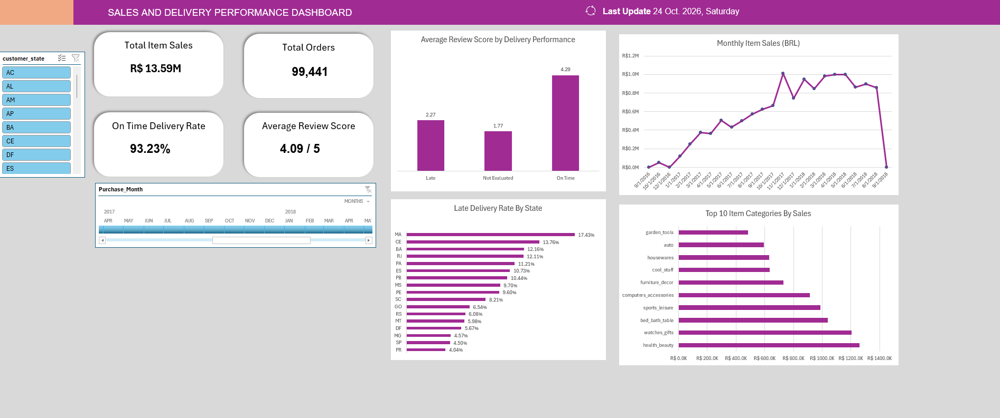

# Olist E-Commerce Sales & Delivery Performance

## Project overview
Historical Brazilian marketplace dataset analyzed with Excel Power Query (M), Power Pivot (DAX), PivotTables, PivotCharts, a purchase-month Timeline and a customer-state slicer.

## Dashboard KPIs
- Item Sales — sum of order-item prices, excluding freight
- Total Orders — distinct orders
- On-Time Delivery Rate — on-time / evaluated deliveries
- Average Order Review — one average per reviewed order

## Analyses
- Monthly sales trend (shown Jan 2017–Aug 2018 to avoid sparsely covered boundary periods)
- Top 10 product categories by recorded item sales
- Late delivery rate by state, with 500+ evaluated deliveries for the regional benchmark
- Review score by delivery performance

## Files
- `Dashboard.xlsx` — source Excel workbook, Power Query/Data Model, interactive dashboard and PivotCharts
- `docs/analysis_findings.md` — findings, evidence, limitations and recommendations
- `docs/Olist_Data_Quality_and_Methodology.xlsx` — data-quality issue log, integrity checks, definitions
- `Data/` — original public dataset CSVs (credit Olist, respect source license)

## Findings
On-time deliveries were associated with higher customer reviews (4.29/5 vs 2.27/5 for late), and regions varied considerably in late-delivery rate. Sales were concentrated in categories including Health & Beauty and Watches & Gifts. These findings are descriptive and observational.

## Refresh and limitations
Open the Excel workbook in a desktop version of Excel supporting Power Query and Power Pivot. Refresh data connections and confirm PivotTables/PivotCharts recalculate. The model uses historical anonymized marketplace data, not company financial-statement revenue; categories lack readable individual product names. Incomplete boundary months are excluded from the trend visual, not necessarily from all KPI measures.
